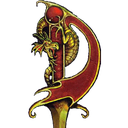

<p align="center"></p>

<h1 align="center">DFO Companion</h1>

<p align="center"><em>A quiet second-monitor dashboard for Daggerfall Online.</em></p>

<p align="center">
  <a href="https://github.com/yedgar93/dfo-companion/releases"><strong>Download</strong></a> ·
  <a href="#connecting-to-the-game">Connect to the game</a> ·
  <a href="#troubleshooting">Troubleshooting</a> ·
  <a href="docs/DEVELOPMENT_HANDOFF.md">Developer docs</a>
</p>

DFO Companion is a **fan-made, unofficial** desktop app for **Windows** and **Apple Silicon Macs**. It shows your Daggerfall Online (DFO) character on a second screen or your phone, so you can check gear, quests and maps without leaving the game. It is not affiliated with or endorsed by Bethesda or the DFO developers.

## Contents

- [Features](#features)
- [Install](#install)
- [Connecting to the game](#connecting-to-the-game)
- [FAQ](#faq)
- [Troubleshooting](#troubleshooting)
- [Privacy and safety](#privacy-and-safety)
- [Building from source](#building-from-source)
- [Documentation](#documentation)
- [Scope and credits](#scope-and-credits)

## Features

| Area | What you get |
| --- | --- |
| **Gear and pack** | Worn equipment with the game's own item art, inventory search (names and bonuses), sorting, and conservative upgrade comparisons. |
| **Character** | Character sheet with vitals and attributes. |
| **Map** | Town maps with zoom, pan, follow and pinned destinations; a 3D dungeon view; nearby services. |
| **Journal** | Active quests and their recorded details. |
| **Phone view** | Optional view on your phone, paired by scanning a QR code. No PIN or code to type. |
| **Quiet alerts** | Low health, worn-out gear and heavy load warnings, shown in the dashboard only. No sounds or OS notifications, and you can turn them off. |
| **Optional VoiceBox** | Local Kokoro NPC speech with an enable checkbox and volume slider in Connection. Downloads voices once; see [VoiceBox setup and coverage](docs/VOICEBOX.md). |
| **Auto-updates** | Checks GitHub Releases at startup and every five minutes, then updates and reopens only the companion. |

## Install

Download the latest build from **[GitHub Releases](https://github.com/yedgar93/dfo-companion/releases)**.

| Platform | File | Notes |
| --- | --- | --- |
| Windows | Installer (`.exe`) | Standard NSIS installer. |
| Mac (Apple Silicon) | `.dmg` or `.zip` | Ad-hoc signed, so macOS may ask you to confirm with **Open Anyway** the first time. Install into a writable folder such as `~/Applications` so updates can replace the app. |

Electron is bundled, so you don't need to install Node. After the first install, the app updates itself.

## Connecting to the game

### Step by step

1. **Save and fully quit DFO.** Close it all the way, not just to the menu.
2. **Open DFO Companion.**
3. Go to the **Connection** tab.
4. Press **Start game with companion connection**. The companion first checks that DFO is fully closed.
5. DFO starts. Choose **Play** and load your character as usual.
6. Once your character is read, the Connection tab says *"Connected. Your character is being read normally."*

If DFO is still running when you press the button, the companion refuses to start a second copy. Quit DFO yourself and press the button again.

### Why it has to be this way

- **The connection can only be switched on when DFO starts.** DFO has no official API for outside apps. The companion reads your character through a local debugging connection (the Chrome DevTools Protocol on `127.0.0.1`, port `9223`), and DFO only opens that connection if it is started with the matching flags (`--remote-debugging-address=127.0.0.1 --remote-debugging-port=9223`).
- **A game that is already running can't be connected afterwards.** Those flags can't be added to a running program. This is why DFO has to be started by the companion.
- **The companion never closes or restarts your game.** Doing that could lose unsaved progress, so it's always your call to quit DFO.
- **Everything stays on your computer.** The connection only listens on loopback (`127.0.0.1`). The companion won't use port 9223 if another program owns it or if it's reachable from outside your computer. Your game files, shortcuts and updater are left unchanged.

## FAQ

<details>
<summary><strong>Why can't it attach to my already-running game?</strong></summary>

The local debugging connection only exists when DFO is started with it switched on. A normal launch doesn't open it, and nothing can add it later. Save, quit DFO, then use **Start game with companion connection**.
</details>

<details>
<summary><strong>Why doesn't the companion just restart DFO for me?</strong></summary>

You could lose unsaved progress. The companion is designed never to close, restart or control the game.
</details>

<details>
<summary><strong>Do I have to do this every time?</strong></summary>

Yes, whenever you start DFO. If you launch DFO from its normal shortcut, the companion can't see it until you quit and relaunch through the companion.
</details>

<details>
<summary><strong>Does it slow the game down?</strong></summary>

It is built to stay light. It copies a small snapshot in idle moments and backs off automatically if copying gets expensive. The first connection can cause a one-time hitch. UI actions, maps, comparisons and update checks don't add game reads.
</details>

<details>
<summary><strong>Can it control my character or change the game?</strong></summary>

No. It only reads your own character. Item swap previews and map pins happen in the companion, never in DFO.
</details>

<details>
<summary><strong>What happens after a DFO update?</strong></summary>

The companion checks the game's code before reading and recognises most new builds automatically. If a build has changed in a way it can't verify, it refuses to read until a compatible companion release is available.
</details>

## Troubleshooting

| Symptom | What to try |
| --- | --- |
| "Checking whether DFO is fully closed…" then an error | DFO (or a leftover process) is still running. Quit it fully, then try again. |
| Game started from its own shortcut, no data | Expected. Quit DFO and start it with **Start game with companion connection**. |
| Port 9223 warning | Another program is using port 9223. Close it, then relaunch DFO through the companion. |
| Some item pictures are missing | Some artwork needs the one-time game data (ARENA2) folder selection. A few new or custom items aren't mapped yet. |
| "Another companion helper is already running" | Quit the old companion, then reopen the app. |
| Mac won't open the app | Use **Open Anyway** in System Settings › Privacy & Security. |
| Phone view stopped working | Scan a fresh QR code from the Connection tab. Pairing links expire after a short time. |

## Privacy and safety

- **Read-only.** Reads only your own character, quests and location. It never sends game commands.
- **Local only.** The game connection is loopback-only. The phone view is served from your computer and needs a QR pairing. No AI or cloud services are used for the dashboard.
- **Never controls the game.** It never closes, restarts or modifies DFO, including during companion updates.
- **Signed updates.** Mac updates are checked against a pinned Ed25519 key, and Windows uses the standard NSIS updater.
- **Nothing bundled.** No game archives, character data or credentials ship with the app. Game artwork is read from your own install and cached locally.

## Building from source

Requires **Node 22.15+**.

```sh
git clone https://github.com/yedgar93/dfo-companion.git
cd dfo-companion
npm ci
npm start
```

| Command | Purpose |
| --- | --- |
| `npm test` | Isolated tests with mocked game data. Never connects to the game. |
| `npm run test:visual` | Offscreen Electron desktop and phone checks with synthetic fixtures. Results go to `visual-results/`. |
| `npm run test:mobile` | WebKit and Chromium touch checks at three phone sizes. Run `npx playwright install webkit chromium` first. These are emulation checks, not real iPhone checks. |
| `npm run test:mobile:live` | Checks the installed companion's paired phone view. Keep the captures private. |
| `npm run dist:win` | Builds the Windows installer (run on Windows). |
| `npm run dist:mac` | Builds the Apple Silicon app, ZIP and DMG (run on macOS). |

## Documentation

| Document | For |
| --- | --- |
| [AGENTS.md](AGENTS.md) | Repository working rules (read first). |
| [Development handoff](docs/DEVELOPMENT_HANDOFF.md) | Game integration findings, performance rules, known gaps. |
| [Releasing](docs/RELEASING.md) | Release pipeline, signing and auto-updates. |
| [Portable build](src/PORTABLE.md) | Single-file portable companion and connection details. |
| [Contributing](CONTRIBUTING.md) | Ground rules for changes. |

## Scope and credits

This is an unofficial community project. Original game archives, character snapshots, connection tokens and game installs aren't included. The Daggerfall icon is used only to identify the app. Original game artwork belongs to its rights holders. Third-party notices are in [THIRD-PARTY-NOTICES.txt](THIRD-PARTY-NOTICES.txt) and [LICENSE](LICENSE).

Created by **[Yedgar](https://www.yedgar.ca/)**.
